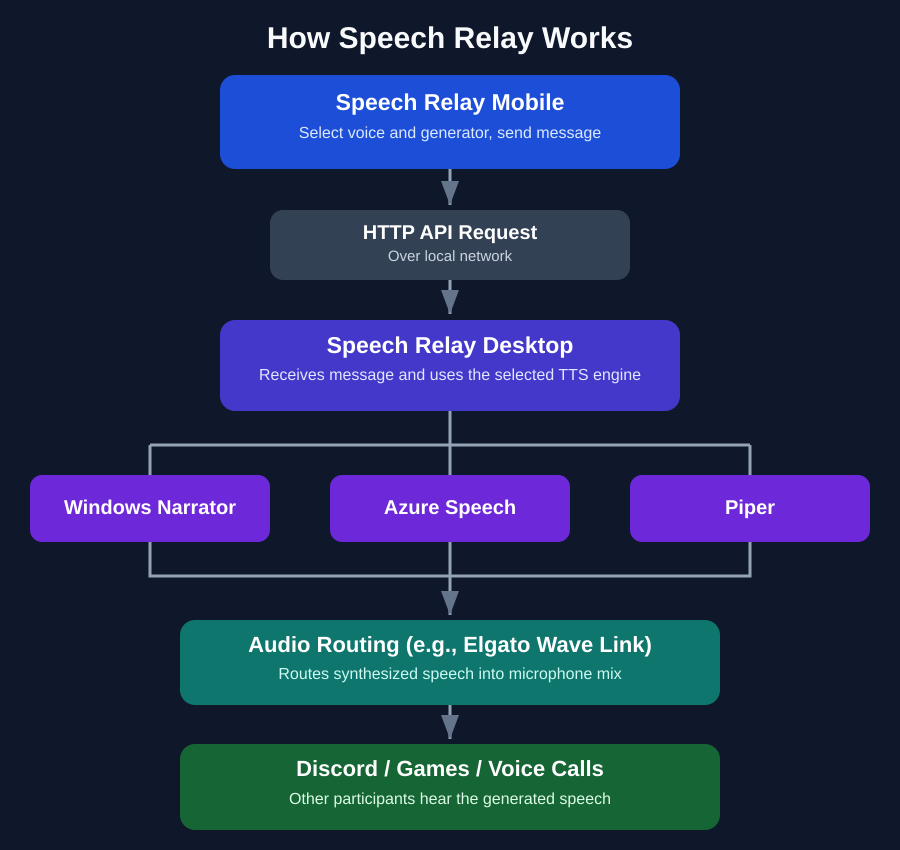

# Speech Relay

Speech Relay is essentially a remote text-to-speech microphone application. It lets you type a message on your phone and have it spoken aloud through your computer's audio setup, so other people can hear it in Discord, voice calls, games, or other applications. A way to communicate through voice chat without needing to speak into a microphone yourself.

A few things distinguish it from a typical TTS application:
- Remote control: Type from your phone while the PC handles the audio
- Multiple speech engines: Choose between Windows speech synthesis, Azure Speech, and Piper
- Virtual microphone support: Route the generated audio into applications that normally expect microphone input
- Local desktop input: Generate speech directly from the PC application as well

## How It Works

<p align="center">
  
</p>

<details>
<summary><strong>Getting Started</strong></summary>

### Requirements
- A Windows PC running Speech Relay Desktop
- A phone running Speech Relay Mobile
- Both devices connected to the same local network
- Optional: Elgato Wave Link or another virtual audio routing solution

### 1. Configure Windows Networking

Speech Relay Desktop uses `HttpListener` to receive HTTP requests from the mobile application over your local network.

Windows may require a URL reservation before the application can listen on port `5000`.

Open **Command Prompt as Administrator** and run:

```cmd
netsh http add urlacl url=http://*:5000/speak/ user=Everyone
```

Next, allow incoming connections through Windows Firewall:

```cmd
netsh advfirewall firewall add rule name="Speech Relay 5000" dir=in action=allow protocol=TCP localport=5000
```

**Security Note:** These commands allow the application to listen for requests on port 5000. They do not configure internet port forwarding, but they can make the service accessible to other devices that can reach your PC. Speech Relay is intended for use on trusted local networks. Requests require the configured authentication token.

### 2. Connect Your Phone

1. Launch Speech Relay Desktop.
2. Find the PC's local IP address displayed in the application.
3. Open Speech Relay Mobile.
4. Enter your PC's IP address.
5. Select a speech generator and voice.
6. Type a message and send it.

Your PC should receive the message, generate speech, and play the resulting audio.

### 3. Configure Audio Routing (Optional)

To let other people hear Speech Relay in Discord, games, or voice calls:

1. Install and configure Elgato Wave Link or another compatible virtual audio solution.
2. Route Speech Relay's audio output into the desired audio mix.
3. Configure your voice chat application to use the corresponding virtual microphone input.
4. Send a test message from Speech Relay Mobile.

The generated speech should now be audible to other participants.

</details>

<details>
<summary><strong>Windows Network Cleanup</strong></summary>

The following steps are for when you no longer want to use this application and want to remove the Windows networking configuration.

Open **Command Prompt as Administrator** and run:

```cmd
netsh http delete urlacl url=http://*:5000/speak/
```

```cmd
netsh advfirewall firewall delete rule name="Speech Relay 5000"
```

These commands remove the URL reservation and firewall rule created during setup.

</details>

<details>
<summary><strong>Speech Engines</strong></summary>

| Engine | Description |
|---|---|
| Windows Speech | Uses voices available through Windows speech synthesis |
| Azure Speech | Uses Microsoft's cloud-based speech synthesis service (requires an API key) |
| Piper | Provides local, offline text-to-speech using downloadable voice models |

Some speech engines require additional setup, credentials, or model downloads.

</details>

<details>
<summary><strong>Additional Notes</strong></summary>
More detailed setup instructions, downloadable executables, and application screenshots will be added in a future update. Speech Relay has currently only been tested on Android and Windows. Compatibility with other platforms has not been verified. This is a personal, open-source project developed in my spare time, so updates, maintenance, and support will be limited.
  
</details>
