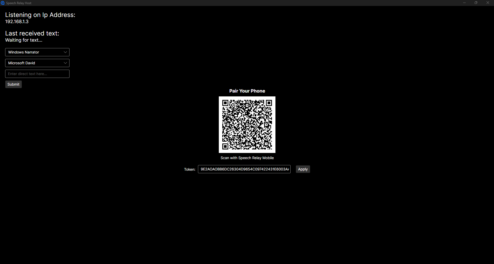
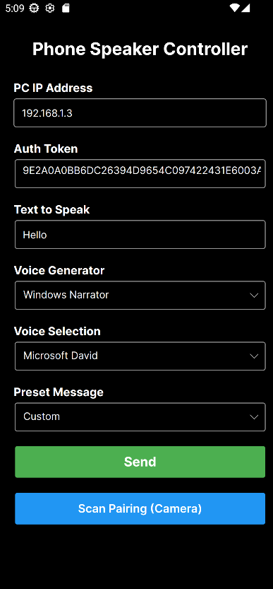
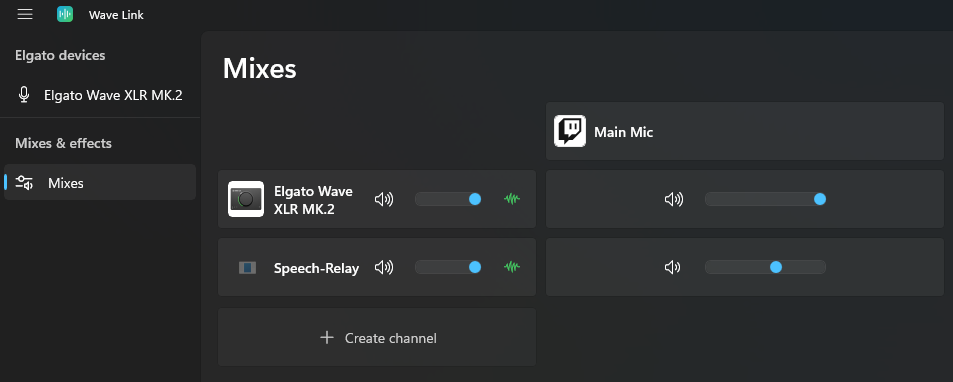

# Speech Relay
Speech Relay is a remote text-to-speech (TTS) application that lets you type messages on your phone and have them spoken aloud through your computer. With compatible audio routing software, the generated speech can be heard by others in Discord, voice calls, games, and other applications. It provides a way to communicate through voice chat without having to speak into a microphone yourself when you are away from your mic.

A few things distinguish it from a typical TTS application:
- Remote control: Type from your phone while the PC handles the audio
- Multiple speech engines: Choose between Windows speech synthesis, Azure Speech, and Piper
- Audio routing support: Route generated speech into voice chat applications using third-party audio routing software, such as Elgato Wave Link or Voicemeeter.
- Local desktop input: Generate speech directly from the PC application as well

## How It Works

<p align="center">
  
</p>

<details>
<summary><strong>Getting Started</strong></summary>

### Requirements
- A Windows PC running Speech Relay Desktop
- A phone running Speech Relay Mobile
- Both devices connected to the same local network
- Optional: Elgato Wave Link or another virtual audio routing solution

### 1. Configure Windows Networking

Speech Relay Desktop uses `HttpListener` to receive HTTP requests from the mobile application over your local network.

Windows may require a URL reservation before the application can listen on port `53317`.

Open **Command Prompt as Administrator** and run:

```cmd
netsh http add urlacl url=http://*:53317/speak/ user=Everyone
```

Next, allow incoming connections through Windows Firewall:

```cmd
netsh advfirewall firewall add rule name="Speech Relay 53317" dir=in action=allow protocol=TCP localport=53317
```

**Security Note:** These commands allow the application to listen for requests on port 53317. They do not configure internet port forwarding, but they can make the service accessible to other devices that can reach your PC. Speech Relay is intended for use on trusted local networks. Requests require the configured authentication token.

### 2. How to Use
1. Launch Speech Relay Desktop.
   <p align="center">
     
   </p>
2. Find the PC's local IP address displayed in the application.
3. Open Speech Relay Mobile.
4. Enter your PC's IP address or scan the QR code to pair.
   <p align="center">
     
   </p>
5. Select a speech generator and voice.
6. Type a message and send it.

Your PC should receive the message, generate speech, and play the resulting audio.

### 3. Configure Audio Routing (Optional)
To let other people hear Speech Relay in Discord, games, or voice calls:

1. Install and configure Elgato Wave Link or another compatible virtual audio solution.
2. Route Speech Relay's audio output into the desired audio mix. The example below shows an Elgato Wave Link setup with a microphone as the primary audio source and Speech Relay configured as an additional audio source.

   <p align="center">
     
   </p>
3. Configure your voice chat application to use the corresponding virtual microphone input.
4. Send a test message from Speech Relay Mobile.

The generated speech should now be audible to other participants. There are also other applications that can route audio other than Elgato Wave Link like Voicemeeter.

### 4. Configure App Settings (Optional)
The `appsettings.json` file contains configuration options that can be customized to suit your preferences. Modifying these settings requires running the application from source.

Available settings include:
- **Authentication Token:** Set a custom token used to authenticate requests between the desktop and mobile applications.
- **Default IP Address:** Specify the default IP address used by the application.
- **Azure Speech Key:** Configure your Azure Speech API key.
- **Random Token Generation:** Choose whether a new authentication token is generated each time the application starts.

</details>

<details>
<summary><strong>Remove Windows Network Changes (Uninstall)</strong></summary>

The following steps are for when you no longer want to use this application and want to remove the Windows networking configuration.

Open **Command Prompt as Administrator** and run:

```cmd
netsh http delete urlacl url=http://*:53317/speak/
```

```cmd
netsh advfirewall firewall delete rule name="Speech Relay 53317"
```

These commands remove the URL reservation and firewall rule created during setup.

</details>

<details>
<summary><strong>Speech Engines</strong></summary>

| Engine | Description |
|---|---|
| Windows Speech | Uses voices available through Windows speech synthesis |
| Azure Speech | Uses Microsoft's cloud-based speech synthesis service (requires an API key to be set in the appsettings.json) |
| Piper | Provides local, offline text-to-speech using downloadable voice models |

Some speech engines require additional setup, credentials, or model downloads.

### Piper Setup
[Piper](https://github.com/OHF-Voice/piper1-gpl) requires Python and a downloaded voice model.
1. Download and install [Python 3.12.10](https://www.python.org/downloads/release/python-31210/). Select `Add python.exe to PATH` to make Python accessible from the command line.
2. Open Command Prompt and install Piper:
   ```cmd
   python -m pip install piper-tts
   ```
3. Download a voice model. For example, to download the `en_US-joe-medium` voice.:

   ```cmd
   python -m piper.download_voices en_US-joe-medium --download-dir "%USERPROFILE%\PiperModels"
   ```
4. Launch Speech Relay and select Piper as the speech engine.

</details>

<details>
<summary><strong>Additional Notes</strong></summary>
Speech Relay has currently only been tested on Android and Windows. Compatibility with other platforms has not been verified. This is a personal, open-source project developed in my spare time, so updates, maintenance, and support will be limited.
  
</details>
